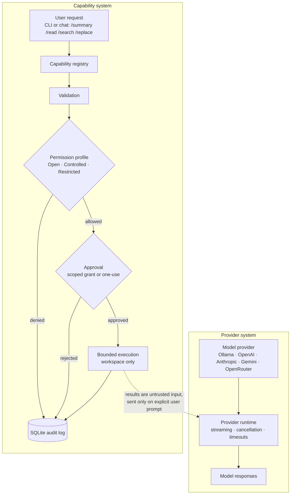

# Venus Agent

<p align="center">
  
</p>

<p align="center">
  <strong>An agent runtime. Your models. Your tools. Your rules.</strong>
  <br>
  Source-available Rust infrastructure for building user-controlled AI agents.
</p>

<p align="center">
  
  
  
</p>

Venus Agent is a Rust runtime for AI agents that you control. The idea is simple: you pick the models, you decide what the runtime can touch, and you decide what it's allowed to do. It ties together model providers, bounded capabilities, permission profiles, and approval workflows, and it gives you a terminal interface to drive all of it.

I want to be honest about where this is. Today Venus gives you provider-backed terminal chat, a bounded workspace summary / file-read / search, and one narrow exact-text replacement that's gated behind a write grant and a fresh approval. General editing and running commands are not built yet.

So treat Venus as an agent runtime in development, not a general-purpose autonomous coding agent.

## At a glance

| Name | What it does | Stack | Demo |
|---|---|---|---|
| **Venus Agent** | Source-available Rust runtime for user-controlled AI agents: your models, bounded capabilities, permissions, and approvals | Rust · Ratatui · SQLite | [Console session](docs/demo.md) · [See it run](#see-it-run) |

> There's no hosted link, because Venus is a local terminal runtime. The reproducible demo is the full console session in [`docs/demo.md`](docs/demo.md), summarized under [See it run](#see-it-run).

> [!IMPORTANT]
> Permission profiles and approvals are **application-level policies**, not OS-level security. Venus doesn't sandbox itself, so a compromised process or a malicious local user can bypass them. See [Security considerations](#security-considerations) and [`SECURITY.md`](SECURITY.md).

## What works today

Here's what's actually wired up right now:

- Provider choices: Ollama, OpenAI, Anthropic, Google Gemini, and OpenRouter, each with its own authentication and model discovery.
- Model configuration: you choose providers and models through configuration.
- Streaming: asynchronous responses, cancellation, and request timeouts.
- Interactive chat: a Ratatui terminal conversation with model switching and in-memory context.
- Capabilities: a registry for describing and discovering the available operations.
- Permissions: Open, Controlled, and Restricted profiles.
- Approvals: scoped grants, revocation, expiration, and one-use approvals.
- Persistence: SQLite-backed state, permission data, and audit history.
- Bounded workspace access: workspace summary, visible UTF-8 file reads, literal text search, and exact single-line replacement with explicit approval.

One caveat worth stating up front. Ollama is the only provider I've run real local inference against, including a fresh setup. OpenAI, Anthropic, Gemini, and OpenRouter have deterministic mocked HTTP tests only; no real cloud credentials or vendor inference have gone through them. So I don't consider those cloud integrations independently verified as production-ready.

## See it run

This is a real session: a write gets denied without a grant, then it needs approval for its exact arguments, then it runs and lands in the audit log.

```console
$ venus-agent capability run workspace.file-replace replace --input "$INPUT"
Proposed replacement:
-     // TODO: handle config errors
+     // Config errors are handled in load_config()
Error: Capability request denied: No active grant covers this capability version, operation, and required permissions

$ venus-agent permission grant workspace.file-replace 1.0.0 replace --permission workspace.write
Created grant #1.

$ venus-agent capability run workspace.file-replace replace --input "$INPUT"
Approval required for request #6: A request-specific user approval is required

$ venus-agent permission approve 1
Approved request #6 for workspace.file-replace operation replace; the approval is single-request and no operation was executed.

$ venus-agent capability run workspace.file-replace replace --input "$INPUT" --approval-id 1
Completed capability request #6:
{ "path": "src/main.rs", "sha256": "8b43b323…", "size_bytes": 87 }

$ venus-agent permission audit
… decision=allowed  reason=The active grant and matching request-specific user approval authorize this request status=completed
… decision=approved reason=User approved this exact capability request status=approved
… decision=approval_required status=proposed
… decision=denied   reason=No active grant covers this capability version, operation, and required permissions status=denied
```

I trimmed the output here for length. The full, unedited session is in [`docs/demo.md`](docs/demo.md).

## Tested

There are **103 tests** (`cargo test --locked`), all deterministic, with no network or credentials needed:

| Module | Tests | Covers |
|---|---:|---|
| `provider` | 26 | Request/stream parsing for every adapter against local mock HTTP servers, cancellation, timeouts |
| CLI + terminal chat | 18 | Setup wizard, model switching, slash commands, approval and preview flows in chat |
| `database` | 16 | SQLite state, grants, approvals, audit events |
| `config` | 12 | Atomic saves, validation, rejecting credentials in URLs and plaintext remote endpoints |
| `orchestrator` | 11 | Authorization → execution → audit lifecycle, cancellation, failures |
| `repository` | 11 | Workspace visibility rules, bounded reads and search |
| `permissions` | 6 | Open / Controlled / Restricted decisions, argument summaries never leak values |
| `capability` | 3 | Registry and descriptors |

I don't measure line coverage yet.

**Provider compatibility**

| Provider | Implemented | Mock-tested | Verified with real inference |
|---|:---:|:---:|---|
| Ollama | ✅ | ✅ | ✅ `qwen3.5:0.8b`, `qwen3.5:2b`, `qwen2.5-coder:3b` |
| OpenAI | ✅ | ✅ | ❌ not yet |
| Anthropic | ✅ | ✅ | ❌ not yet |
| Google Gemini | ✅ | ✅ | ❌ not yet |
| OpenRouter | ✅ | ✅ (shared OpenAI-compatible adapter) | ❌ not yet |
| Azure OpenAI | ❌ | — | — |

I've verified this on macOS (Apple Silicon). Linux and Windows aren't validated yet. More detail in [`docs/providers.md`](docs/providers.md).

## Get started

### 1. Install

```bash
git clone https://github.com/aymane-amounas/venusAgent.git
cd venusAgent
./scripts/install.sh
```

On macOS and Linux, if the Rust toolchain is missing, the installer offers to install the minimal toolchain from the official Rustup site, then builds and installs Venus Agent. It also checks for a native C compiler and gives platform-specific guidance if one is missing. Cargo fetches and builds the Rust dependencies on its own; there's no separate database or Python install. The commands land in Cargo's binary directory (`~/.cargo/bin`). If that's not on your `PATH`, the installer offers to add it to your zsh or bash startup file. Accept, then run the printed `source` command in the current terminal (or open a new one). If you decline, or you use another shell, add `~/.cargo/bin` to your `PATH` yourself.

On Windows, install Rust with [rustup.rs](https://rustup.rs), then run `cargo install --path . --locked` from the cloned repository.

```bash
venus-agent --help
```

### 2. Configure a model

On first launch, Venus checks whether Ollama is running and has models installed. If it does, Venus picks an available one (it prefers a coding-named model) and configures it automatically. It never downloads a model for you. If Ollama isn't there or has no models, you can set up a cloud provider or skip setup and do it later.

Cloud setup covers OpenAI, Anthropic, Gemini, and OpenRouter. Set the provider's standard API-key environment variable before setup: `OPENAI_API_KEY`, `ANTHROPIC_API_KEY`, `GEMINI_API_KEY`, or `OPENROUTER_API_KEY`. Credentials stay out of the TOML, but keep in mind an environment variable isn't an OS keychain and can be visible to other processes running as your user. Venus checks authentication, discovers models, then asks before sending one short inference request (provider usage may apply). Azure OpenAI and direct Codex authentication aren't supported. The cloud adapters have mocked protocol tests only; they haven't been run against real cloud credentials or inference.

### 3. Start chatting

From your project directory, start the interactive terminal:

```bash
venus
```

`venus` is the short command; `venus-agent` is also installed and does the same thing with the same configuration. The full-screen chat streams replies and shows the active provider, model, and permission profile next to the Venus mark. Type `/help` to see the in-chat commands:

- `/model` or `/models` lists configured models; `/model <provider> <alias-or-model-id>` switches models.
- `/providers` lists configured providers and whether their credential environment variables are set.
- `/provider test <name>` checks provider connectivity and model discovery; `/provider switch <name> <model>` switches models for the current chat.
- `/permissions` explains the active capability permission profile.
- `/summary` runs the bounded, read-only workspace summary. If policy requires approval, Venus shows the request scope and accepts `/approve <id>` or `/deny <id>`.
- `/read <relative-path>` reads one visible UTF-8 file (up to 256 KiB); `/search <literal-query>` searches visible text files. Both use the `workspace.read` permission policy. Results are added as untrusted in-memory context and sent to the selected provider only with your next prompt.
- `/replace <path> <old text> => <new text>` previews one unique, single-line replacement. Nothing changes on disk until you grant `workspace.write` and approve the exact request with `/approve <id>`.
- `/clear` clears the in-memory conversation; `/exit` leaves the chat. `Ctrl-C` cancels a request or exits.

The selected provider is explicit. If it's unavailable, Venus reports the error and doesn't silently fail over or send your context to a different provider. Chat history lives in memory for the current run only. It isn't stored in SQLite; only provider/model and token-count metadata is persisted. Earlier turns go only to the selected provider. Workspace access happens only when you explicitly use `/read`, `/search`, or `/replace`, and those results enter model context only when you send your next prompt. `/replace` can make one exact, unique single-line replacement, but only after showing a diff and getting a fresh approval. Venus doesn't run shell commands or execute model-proposed tool calls.

## Managing providers

Use the shell commands when you want to add, inspect, switch, or remove providers:

```bash
venus provider list
venus provider add
venus provider check <name>
venus provider models <name>
venus provider test <name> --model <alias-or-id>
venus provider switch <name> <model>
venus provider remove <name> --yes
```

`venus-agent` works in place of `venus` everywhere. `provider switch` sets the default for new chats. Provider failures never trigger an automatic fallback. The existing CLI commands are all still there, for example `venus-agent inspect` and `venus-agent capability list`.

A note on Codex, since people ask: OpenAI Codex CLI is a separate coding-agent runtime, not an ordinary model provider. OpenAI documents `codex exec` for programmatic use, but Venus doesn't delegate to it or reuse Codex's ChatGPT sign-in or API-key credentials. See [Codex authentication](https://developers.openai.com/codex/auth/), [Codex CLI](https://developers.openai.com/codex/cli/), and [Codex developer commands](https://developers.openai.com/codex/developer-commands/).

## Capabilities and permissions

The core idea here is that what a model proposes and what the runtime is allowed to execute are two different things.

Every capability declares its operation and its effects. The runtime validates the request, evaluates permissions, handles any required approval, checks authorization again right before execution, and records the outcome.

There are three permission profiles:

| Profile | Behavior |
| --- | --- |
| Open | Allows the available schema-valid read-only workspace capabilities without a Venus grant or approval. File replacement still requires a `workspace.write` grant and a fresh exact-request approval. Everything stays subject to the process's OS permissions. |
| Controlled | Requires a matching grant; a grant can additionally require per-request approval. |
| Restricted | Requires a matching grant and a new exact-request approval for every run. |

These are application-level controls. They don't replace operating-system permissions and they don't give you OS-level isolation.

### Try the current capability

List the available capabilities:

```bash
venus-agent capability list
```

Run the workspace summary:

```bash
venus-agent capability run workspace.summary summarize
```

The read-only `workspace.file-read` and `workspace.search` capabilities can also be driven from the CLI with JSON input:

```bash
venus-agent capability run workspace.file-read read --input '{"path":"src/main.rs"}'
venus-agent capability run workspace.search search --input '{"query":"TODO","case_sensitive":false}'
```

Summary and search honor ignore rules and skip the usual generated directories. Reads reject hidden, ignored, generated, symlinked, and out-of-workspace files, cap out at 256 KiB, and stop their visibility scan after 100,000 files. Search is literal and bounded to 100,000 files, 16 MiB scanned, 50 matches, and 512-byte snippets. `/replace` is the only write there is: one exact single-line replacement in a visible UTF-8 file up to 256 KiB. It refuses ambiguous or stale content and always needs a `workspace.file-replace` `workspace.write` grant plus fresh approval, including in Open profile. General edits, model-selected tools, and command execution aren't available.

## How it works



Model-generated tool calls aren't connected to the capability system. You start capability requests through the CLI or the chat's `/summary`, `/read`, `/search`, or `/replace` commands; the runtime validates them and applies the application-level permissions. File and search results are treated as untrusted input and reach provider context only after you send an explicit prompt. The replacement path runs only after you preview and approve the exact change.

The whole point of the layout is to keep provider integration, capability definitions, authorization, and execution separate from each other.

## Configuration

Venus uses a local configuration file to define providers and models. Provider credentials come from environment variables rather than being written into the configuration files.

See:

- [`docs/providers.md`](docs/providers.md)
- [`docs/architecture.md`](docs/architecture.md)
- [`docs/capabilities-and-permissions.md`](docs/capabilities-and-permissions.md)

## Development

Clone the repository and build:

```bash
cargo build --locked
```

Run tests:

```bash
cargo test --locked
```

Check formatting:

```bash
cargo fmt --all -- --check
```

Run Clippy:

```bash
cargo clippy --all-targets --locked -- -D warnings
```

## Current scope and milestones

Venus Agent is a developer preview, and the execution scope is deliberately small right now.

| Milestone | Status | Outcome |
| --- | --- | --- |
| 1. Interactive terminal | In place | Streaming chat, commands, model/provider and permission visibility, a guided first-run provider/model setup, and a compact Venus-inspired star-and-orbit mark. |
| 2. Bounded workspace and coding actions | In progress | User-started summary/read/search plus exact single-line replacement with diff preview, a `workspace.write` grant, and fresh request-bound approval. Broader edits/diffs remain next. |
| 3. Controlled agent loop | Later | Model-selected tools with turn limits, cancellation, verification, and recovery; no arbitrary shell by default. |
| 4. Session persistence | Design first | Add only with explicit opt-in, retention, and deletion behavior. |

The terminal identity is part of the product to me, not just decoration, so future terminal milestones should keep and refine the Venus mark and the clear active-model and permission indicators.

What's implemented:

- Provider infrastructure.
- Interactive terminal chat with in-memory multi-turn context.
- Capability registration and discovery.
- Permission profiles and approval workflows.
- SQLite persistence and metadata-only audit events.
- Bounded workspace summary, visible file reads, literal text search, and exact single-line replacement protected by a write grant and explicit approval.

What's not implemented:

- Model-generated tool calls connected to the orchestrator.
- Autonomous agent loops.
- Arbitrary shell execution.
- Arbitrary filesystem modification.
- Multi-agent orchestration.
- OS-level sandboxing.

### Security considerations

A few things I'd want you to know before trusting this with anything sensitive:

- Permission profiles are application policy, not a security boundary against a compromised process.
- Audit records are kept indefinitely right now and are tamper-evident, not tamper-proof.
- The request fingerprint could let someone with database access guess low-entropy inputs.
- Chat transcripts, prompts, and responses aren't persisted; the chat's current-run context lives in memory and goes to the selected provider.
- The latest release verification was on macOS; a full cross-platform validation isn't done.

Read [`SECURITY.md`](SECURITY.md) before using Venus anywhere there's sensitive data.

## Roadmap

I'm building Venus incrementally. The long-term direction is a user-controlled agent runtime where you choose your models, capabilities, integrations, execution environment, and how much autonomy to hand over.

The priority is to make each layer understandable, testable, and secure before widening what the agent can do.

## Contributing

Contributions, bug reports, and technical discussions are welcome.

- [Report an issue](https://github.com/aymane-amounas/venusAgent/issues)
- Read [CONTRIBUTING.md](CONTRIBUTING.md)
- Read [SECURITY.md](SECURITY.md)

## License

Venus Agent is licensed under the [Aymane Amounas Noncommercial Attribution
License 1.0](LICENSE). Noncommercial personal, educational, research, and hobby
use, modification, and redistribution are permitted with required attribution.
Commercial use requires a separate written agreement with the copyright holder.
The [license](LICENSE) specifies downstream source and binary attribution,
preserves third-party terms, and permits private employee experimentation on
personal time and equipment only when unconnected to employer work, resources,
accounts, data, or benefit. See [NOTICE](NOTICE) and
[CONTRIBUTING.md](CONTRIBUTING.md) for notices and contributor terms.

Required attribution:

> Based on Venus Agent (venusAgent) by Aymane Amounas<br>
> <https://github.com/aymane-amounas/venusAgent>

Because commercial use is restricted, this is source-available software, not
OSI-approved open-source software.

Earlier versions distributed under the MIT License remain available under that
license.

---

<p align="center">
  <strong>Venus Agent</strong>
</p>

---

<sub>Built by [Aymane](https://github.com/aymane-amounas)</sub>
