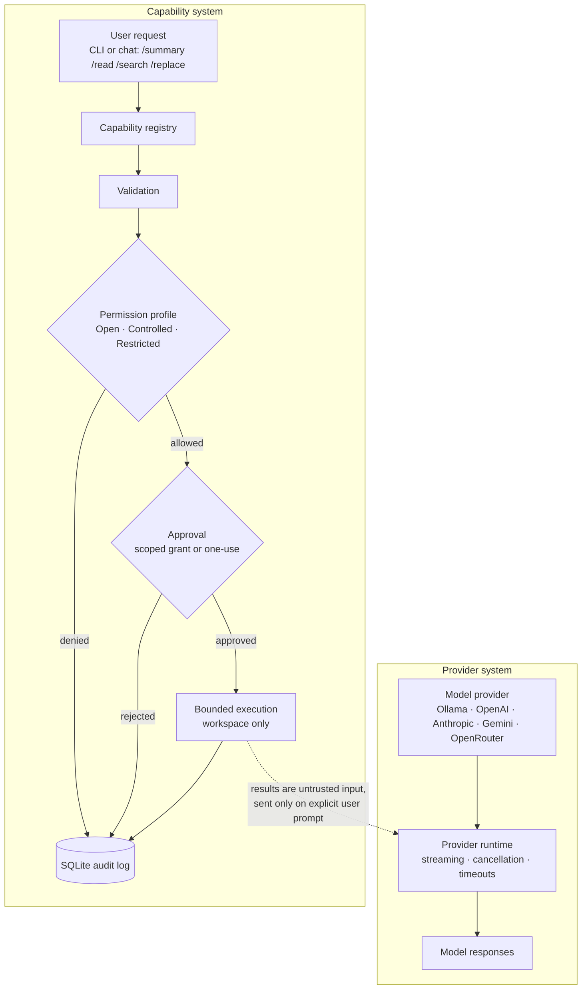

# Venus Agent

<p align="center">
  
</p>

<p align="center">
  <strong>An agent runtime. Your models. Your tools. Your rules.</strong>
  <br>
  Source-available Rust infrastructure for building user-controlled AI agents.
</p>

<p align="center">
  
  
  
</p>

Venus Agent is source-available Rust infrastructure for user-controlled AI agents. It brings model providers, bounded capabilities, permissions, and approval workflows together, with an interactive terminal interface for using them.

Choose your models, control what the runtime can access, and decide what it is allowed to do.

Today, Venus provides provider-backed terminal chat, bounded workspace summary/file-read/search, and one narrow exact-text replacement capability protected by a write grant and fresh approval. General editing and command execution are not implemented.

**Venus is an agent runtime in development, not yet a general-purpose autonomous coding agent.**

> [!IMPORTANT]
> Permission profiles and approvals are **application-level policies**, not OS-level security. Venus does not sandbox itself; a compromised process or a malicious local user can bypass them. See [Security considerations](#security-considerations) and [`SECURITY.md`](SECURITY.md).

## What works today

- **Provider choices:** Ollama, OpenAI, Anthropic, Google Gemini, and OpenRouter, with provider-specific authentication and model discovery.
- **Model configuration:** Choose providers and models through configuration.
- **Streaming:** Asynchronous responses, cancellation, and request timeouts.
- **Interactive chat:** A Ratatui terminal conversation with model switching and in-memory context.
- **Capabilities:** A registry for describing and discovering available operations.
- **Permissions:** Open, Controlled, and Restricted profiles.
- **Approvals:** Scoped grants, revocation, expiration, and one-use approvals.
- **Persistence:** SQLite-backed state, permission data, and audit history.
- **Bounded workspace access:** Workspace summary, visible UTF-8 file reads, literal text search, and exact single-line replacement with explicit approval.

**Provider verification:** Ollama passed real local inference, including fresh setup. OpenAI, Anthropic, Gemini, and OpenRouter have deterministic mocked HTTP test coverage only; no real cloud credentials or vendor inference have been verified. These cloud integrations are not independently verified as production-ready.

## See it run

A real session: a write is denied without a grant, then needs approval for its exact arguments, then runs and is audited.

```console
$ venus-agent capability run workspace.file-replace replace --input "$INPUT"
Proposed replacement:
-     // TODO: handle config errors
+     // Config errors are handled in load_config()
Error: Capability request denied: No active grant covers this capability version, operation, and required permissions

$ venus-agent permission grant workspace.file-replace 1.0.0 replace --permission workspace.write
Created grant #1.

$ venus-agent capability run workspace.file-replace replace --input "$INPUT"
Approval required for request #6: A request-specific user approval is required

$ venus-agent permission approve 1
Approved request #6 for workspace.file-replace operation replace; the approval is single-request and no operation was executed.

$ venus-agent capability run workspace.file-replace replace --input "$INPUT" --approval-id 1
Completed capability request #6:
{ "path": "src/main.rs", "sha256": "8b43b323…", "size_bytes": 87 }

$ venus-agent permission audit
… decision=allowed  reason=The active grant and matching request-specific user approval authorize this request status=completed
… decision=approved reason=User approved this exact capability request status=approved
… decision=approval_required status=proposed
… decision=denied   reason=No active grant covers this capability version, operation, and required permissions status=denied
```

Output trimmed for length. The full, unedited session is in [`docs/demo.md`](docs/demo.md).

## Tested

**101 tests** (`cargo test --locked`), all deterministic, no network or credentials needed:

| Module | Tests | Covers |
|---|---:|---|
| `provider` | 26 | Request/stream parsing for every adapter against local mock HTTP servers, cancellation, timeouts |
| CLI + terminal chat | 18 | Setup wizard, model switching, slash commands, approval and preview flows in chat |
| `database` | 14 | SQLite state, grants, approvals, audit events |
| `config` | 12 | Atomic saves, validation, rejecting credentials in URLs and plaintext remote endpoints |
| `orchestrator` | 11 | Authorization → execution → audit lifecycle, cancellation, failures |
| `repository` | 11 | Workspace visibility rules, bounded reads and search |
| `permissions` | 6 | Open / Controlled / Restricted decisions, argument summaries never leak values |
| `capability` | 3 | Registry and descriptors |

Line coverage is not measured yet.

**Provider compatibility**

| Provider | Implemented | Mock-tested | Verified with real inference |
|---|:---:|:---:|---|
| Ollama | ✅ | ✅ | ✅ `qwen3.5:0.8b`, `qwen3.5:2b`, `qwen2.5-coder:3b` |
| OpenAI | ✅ | ✅ | ❌ not yet |
| Anthropic | ✅ | ✅ | ❌ not yet |
| Google Gemini | ✅ | ✅ | ❌ not yet |
| OpenRouter | ✅ | ✅ (shared OpenAI-compatible adapter) | ❌ not yet |
| Azure OpenAI | ❌ | — | — |

Platform: verified on macOS (Apple Silicon). Linux and Windows are not yet validated. Details: [`docs/providers.md`](docs/providers.md).

## Get started

### 1. Install

```bash
git clone https://github.com/aymane-amounas/venusAgent.git
cd venusAgent
./scripts/install.sh
```

On macOS and Linux, the installer offers to install the minimal Rust toolchain from the official Rustup site if it is missing, then builds and installs Venus Agent. It also checks for a native C compiler and gives platform-specific guidance if one is missing. Cargo fetches/builds Rust dependencies automatically; no separate database or Python installation is needed. The installed commands are in Cargo's binary directory (`~/.cargo/bin`). If that directory is not on `PATH`, the installer offers to add it to your zsh or bash startup file. Accept, then run the printed `source` command in the current terminal (or open a new terminal). If you decline or use another shell, add `~/.cargo/bin` to your `PATH` manually.

On Windows, install Rust with [rustup.rs](https://rustup.rs), then run `cargo install --path . --locked` from the cloned repository.

```bash
venus-agent --help
```

### 2. Configure a model

On first launch, Venus checks whether Ollama is running and has installed models. If so, it selects an available model (preferring a coding-named model) and configures it automatically. It never downloads a model. If Ollama is unavailable or has no models, you can configure a cloud provider or finish setup and do it later.

Cloud setup supports OpenAI, Anthropic, Gemini, and OpenRouter. Set the provider's standard API-key environment variable before setup: `OPENAI_API_KEY`, `ANTHROPIC_API_KEY`, `GEMINI_API_KEY`, or `OPENROUTER_API_KEY`. Credentials stay out of TOML, but environment variables are not an OS keychain and may be accessible to other processes running as your user. Venus checks authentication and discovers models, then asks before sending one short inference request (provider usage may apply). Azure OpenAI and direct Codex authentication are not supported. Cloud adapters have mocked protocol tests only; they have not been verified with real cloud credentials or inference.

### 3. Start chatting

From your project directory, start the interactive terminal:

```bash
venus
```

`venus` is the short command; `venus-agent` is also installed and can be used interchangeably. Both names run the same application and use the same configuration. The full-screen chat streams replies and shows the active provider, model, and permission profile beside the Venus mark. Type `/help` to see the in-chat commands:

- `/model` or `/models` lists configured models; `/model <provider> <alias-or-model-id>` switches models.
- `/providers` lists configured providers and whether required credential environment variables are set.
- `/provider test <name>` checks provider connectivity and model discovery; `/provider switch <name> <model>` switches models for the current chat.
- `/permissions` explains the active capability permission profile.
- `/summary` runs the existing bounded, read-only workspace summary. If policy requires approval, Venus shows the request scope and accepts `/approve <id>` or `/deny <id>`.
- `/read <relative-path>` reads one visible UTF-8 file (up to 256 KiB); `/search <literal-query>` searches visible text files. Both use `workspace.read` permission policy. Results are added as untrusted in-memory context and sent to the selected provider only with your next prompt.
- `/replace <path> <old text> => <new text>` previews one unique, single-line replacement. No file changes until you grant `workspace.write` and approve the exact request with `/approve <id>`.
- `/clear` clears the in-memory conversation; `/exit` leaves the chat. `Ctrl-C` cancels a request or exits.

The selected provider is explicit; if it is unavailable, Venus reports the error and does not silently fail over or send context to another provider. Chat history is held in memory only for the current run. It is not stored in SQLite; only provider/model and token-count metadata is persisted. Prior turns are sent only to the selected provider. Workspace access happens only after you explicitly use `/read`, `/search`, or `/replace`. Results enter model context only when you send your next prompt. `/replace` can make one exact, unique single-line replacement, but only after showing a diff and receiving a fresh approval. Venus does not run shell commands or execute model-proposed tool calls.

## Managing providers

Use the shell commands when you want to add, inspect, switch, or remove providers:

```bash
venus provider list
venus provider add
venus provider check <name>
venus provider models <name>
venus provider test <name> --model <alias-or-id>
venus provider switch <name> <model>
venus provider remove <name> --yes
```

`venus-agent` can be used in place of `venus` for all commands. Switching with `provider switch` sets the default for new chats. Provider failures never trigger automatic fallback. Existing CLI commands remain available, for example `venus-agent inspect` and `venus-agent capability list`.

OpenAI Codex CLI is a separate coding-agent runtime, not an ordinary model provider. OpenAI documents `codex exec` for programmatic use, but Venus does not delegate to it or reuse Codex's ChatGPT sign-in/API-key credentials. See [Codex authentication](https://developers.openai.com/codex/auth/), [Codex CLI](https://developers.openai.com/codex/cli/), and [Codex developer commands](https://developers.openai.com/codex/developer-commands/).

## Capabilities and permissions

Venus separates what a model proposes from what the runtime is allowed to execute.

Every capability has a declared operation and effects. The runtime validates requests, evaluates permissions, handles required approvals, checks authorization again before execution, and records the outcome.

Three permission profiles are available:

| Profile | Behavior |
| --- | --- |
| Open | Allows the available schema-valid read-only workspace capabilities without a Venus grant or approval. File replacement still requires a `workspace.write` grant and fresh exact-request approval. All operations remain subject to the process's OS permissions. |
| Controlled | Requires a matching grant; a grant can additionally require per-request approval. |
| Restricted | Requires a matching grant and a new exact-request approval for every run. |

Permissions are application-level controls. They do not replace operating-system permissions or provide OS-level isolation.

### Try the current capability

List available capabilities:

```bash
venus-agent capability list
```

Run the workspace summary:

```bash
venus-agent capability run workspace.summary summarize
```

The read-only `workspace.file-read` and `workspace.search` capabilities can also be requested from the CLI with JSON input:

```bash
venus-agent capability run workspace.file-read read --input '{"path":"src/main.rs"}'
venus-agent capability run workspace.search search --input '{"query":"TODO","case_sensitive":false}'
```

Summary and search honor ignore rules and skip common generated directories. Reads reject hidden, ignored, generated, symlinked, and out-of-workspace files, are limited to 256 KiB, and stop their visibility scan after 100,000 files. Search is literal and bounded to 100,000 files, 16 MiB scanned data, 50 matches, and 512-byte snippets. `/replace` is the only write: one exact single-line replacement in a visible UTF-8 file up to 256 KiB. It refuses ambiguous or stale content and always requires a `workspace.file-replace` `workspace.write` grant plus fresh approval, including in Open profile. General edits, model-selected tools, and command execution are not available.

## How it works



Model-generated tool calls are not connected to the capability system. A user starts capability requests through the CLI or the interactive chat's `/summary`, `/read`, `/search`, or `/replace` commands; the runtime validates them and applies application-level permissions. File and search results are treated as untrusted input and enter provider context only after an explicit user prompt. The replacement path applies only after the user previews and approves the exact change.

The architecture is designed to keep provider integration, capability definitions, authorization, and execution separate.

## Configuration

Venus uses a local configuration file to define providers and models.

Provider credentials are supplied through environment variables rather than being written directly into configuration files.

See:

- [`docs/providers.md`](docs/providers.md)
- [`docs/architecture.md`](docs/architecture.md)
- [`docs/capabilities-and-permissions.md`](docs/capabilities-and-permissions.md)

## Development

Clone the repository and build:

```bash
cargo build --locked
```

Run tests:

```bash
cargo test --locked
```

Check formatting:

```bash
cargo fmt --all -- --check
```

Run Clippy:

```bash
cargo clippy --all-targets --locked -- -D warnings
```

## Current scope and milestones

Venus Agent is a developer preview. Its current execution scope is intentionally limited.

| Milestone | Status | Outcome |
| --- | --- | --- |
| 1. Interactive terminal | In place | Streaming chat, commands, model/provider and permission visibility, a guided first-run provider/model setup, and a compact Venus-inspired star-and-orbit mark. |
| 2. Bounded workspace and coding actions | In progress | User-started summary/read/search plus exact single-line replacement with diff preview, a `workspace.write` grant, and fresh request-bound approval. Broader edits/diffs remain next. |
| 3. Controlled agent loop | Later | Model-selected tools with turn limits, cancellation, verification, and recovery; no arbitrary shell by default. |
| 4. Session persistence | Design first | Add only with explicit opt-in, retention, and deletion behavior. |

Terminal identity is part of the product, not just decoration: future terminal milestones should preserve and refine the Venus mark and clear active-model/permission indicators.

**Implemented:**
- Provider infrastructure.
- Interactive terminal chat with in-memory multi-turn context.
- Capability registration and discovery.
- Permission profiles and approval workflows.
- SQLite persistence and metadata-only audit events.
- Bounded workspace summary, visible file reads, literal text search, and exact single-line replacement protected by a write grant and explicit approval.

**Not implemented:**
- Model-generated tool calls connected to the orchestrator.
- Autonomous agent loops.
- Arbitrary shell execution.
- Arbitrary filesystem modification.
- Multi-agent orchestration.
- OS-level sandboxing.

### Security considerations

- Permission profiles are application policies, not security boundaries against a compromised process.
- Audit records currently have indefinite retention and are not tamper-proof.
- Request fingerprints may allow guessing low-entropy inputs by someone with database access.
- Chat transcripts, prompts, and responses are not persisted; the chat's current-run context is held in memory and sent to the selected provider.
- The latest release verification was performed on macOS; a complete cross-platform validation has not been completed.

Read [`SECURITY.md`](SECURITY.md) before using Venus in environments containing sensitive data.

## Roadmap

Venus is being developed incrementally.

The long-term direction is a user-controlled agent runtime where people can choose their models, capabilities, integrations, execution environment, and autonomy.

The priority is to make each layer understandable, testable, and secure before expanding what the agent can do.

## Contributing

Contributions, bug reports, and technical discussions are welcome.

- [Report an issue](https://github.com/aymane-amounas/venusAgent/issues)
- Read [CONTRIBUTING.md](CONTRIBUTING.md)
- Read [SECURITY.md](SECURITY.md)

## License

Venus Agent is licensed under the [Aymane Amounas Noncommercial Attribution
License 1.0](LICENSE). Noncommercial personal, educational, research, and hobby
use, modification, and redistribution are permitted with required attribution.
Commercial use requires a separate written agreement with the copyright holder.
The [license](LICENSE) specifies downstream source and binary attribution,
preserves third-party terms, and permits private employee experimentation on
personal time and equipment only when unconnected to employer work, resources,
accounts, data, or benefit. See [NOTICE](NOTICE) and
[CONTRIBUTING.md](CONTRIBUTING.md) for notices and contributor terms.

Required attribution:

> Based on Venus Agent (venusAgent) by Aymane Amounas<br>
> <https://github.com/aymane-amounas/venusAgent>

Because commercial use is restricted, this is source-available software, not
OSI-approved open-source software.

Earlier versions distributed under the MIT License remain available under that
license.

---

<p align="center">
  Built with curiosity. Designed for user control.
  <br><br>
  **Venus Agent**
</p>

---

<sub>Built by [Aymane](https://github.com/aymane-amounas)</sub>